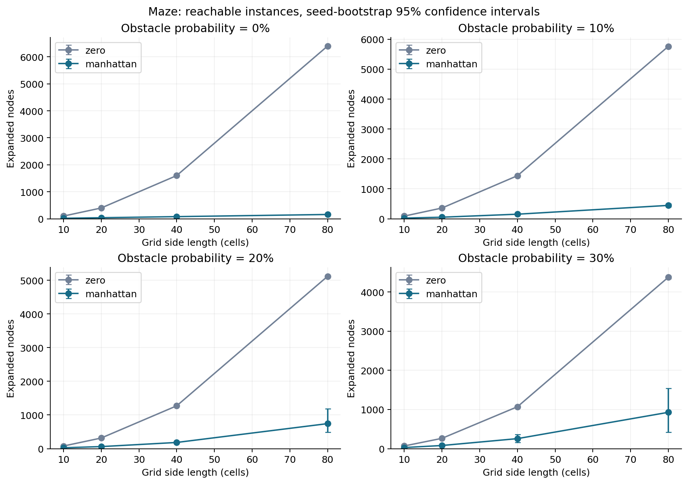
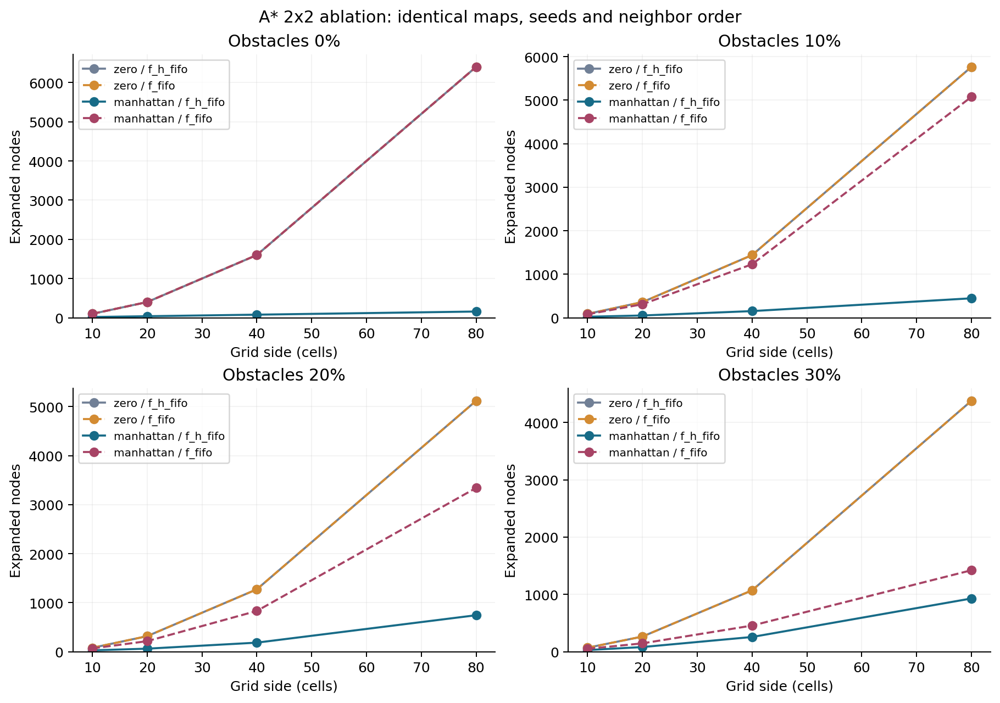
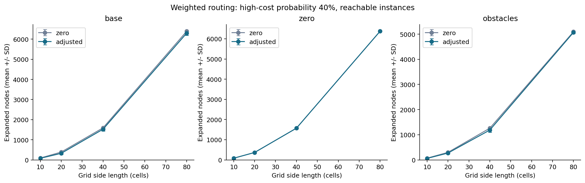
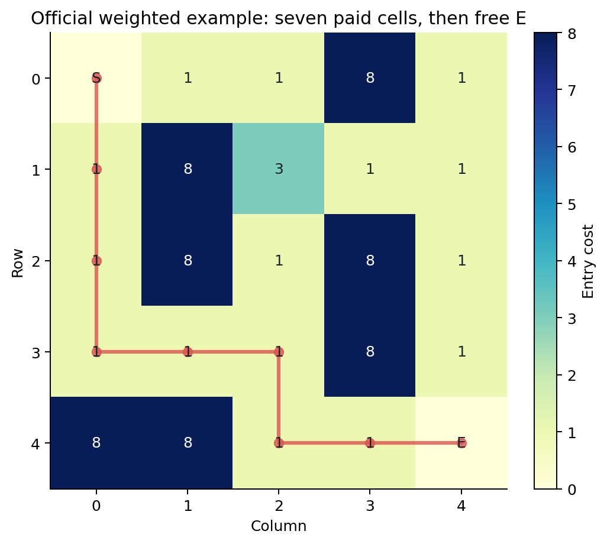
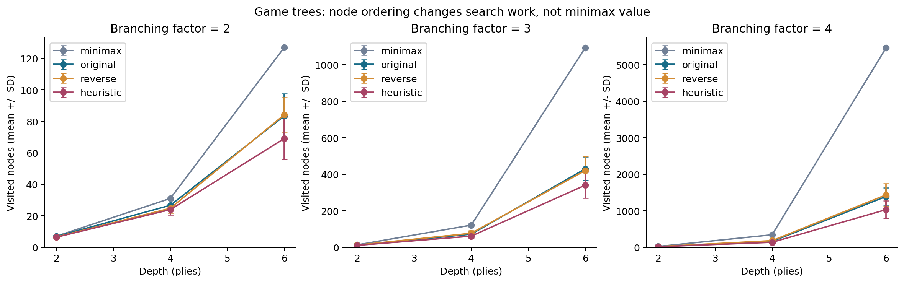
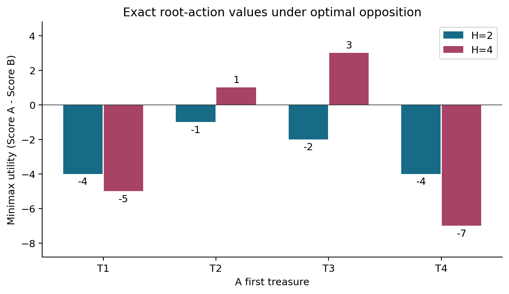
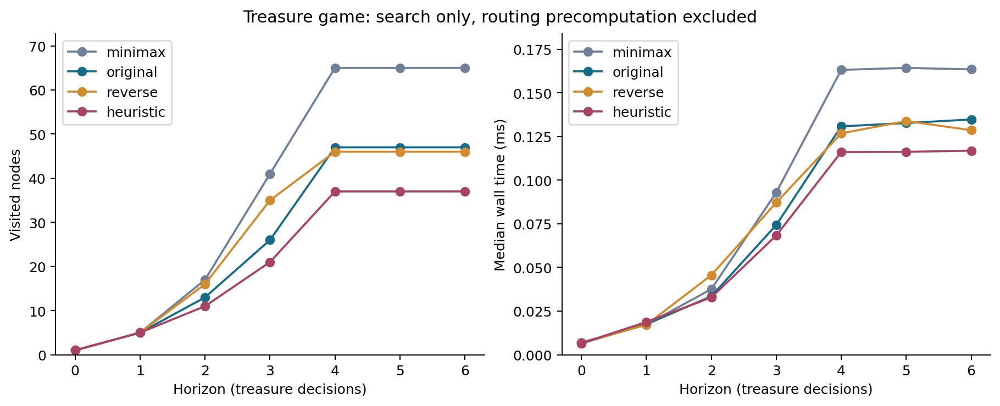
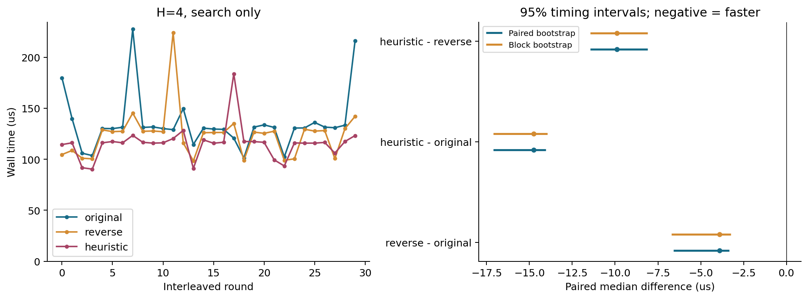
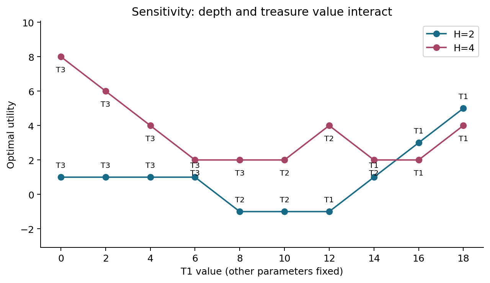

# 当代人工智能实验二：搜索算法

数据批次：`20261020T032620Z-6b476869`。本文所有时间、统计表和图表均来自本批CSV，文件哈希见 `results/raw/batch_manifest.json`。

## 摘要

本实验实现四方向迷宫A*、加权A*、Minimax、Alpha-Beta及宝藏对抗博弈。核心搜索使用Python标准库编写，以独立BFS、Dijkstra和动作序列穷举交叉验证。自动测试共522项，失败0项、跳过0项；完整实验保存13560次测量，最优值核对13560/13560一致。

在80×80无障碍迷宫中，零启发式平均扩展 6399 个节点，曼哈顿为 158 个；该结果受到明确的 (f,h,序号) 排序影响。加权地图因 E 免费而采用 max(d-1,0)×w_min，80×80、40%高权场景的配对扩展减少率为 1.5%。四分支六层合成树中，Minimax 平均访问 5461 节点，原始顺序 Alpha-Beta 为 1389.950。宝藏博弈的 H=2 得 T2/-1，H=4 得 T3/3。即时收益排序在官方 H=4 中访问 37 节点，原始剪枝为 47；是否节省时间应与排序开销共同判断。结论仅覆盖本实验分布和规模。

## 1. 实验目标与需求依据

四题依次研究单位边权下的启发式搜索、非均匀边权下的代价最优性、对抗环境中的效用回传与剪枝，以及路径代价对长期策略的影响。题1、题2和题4的距离计算共用一个A*核心；题3以完整递归Minimax作为剪枝对照。题4另用动作序列穷举独立计算得分和效用，与两种搜索结果交叉核对。

课程PDF第3–7页给出迷宫和加权地形，第8–13页给出博弈树，第14–15页给出宝藏地图与收益，第16–17页说明报告要求和评分标准。题2进入E免费；题4的A、B和宝藏格进入成本均为1。接口约定与测试设计见 `../docs/specification.md`。

## 2. 数学建模、算法与正确性

### 2.1 单位代价迷宫

状态 s=(row,col)，动作集合为上、下、左、右，越界或 X 无后继。每条合法边代价为1；g(start)=0，g(v)=g(u)+1。启发式 h(s)=|row-row_E|+|col-col_E|，f=g+h。任何四邻接路径至少需要曼哈顿距离这么多步，障碍只能增加必要路程，所以 h 可采纳。相邻格的曼哈顿差至多1，h(u)≤1+h(v)，因此一致。

开放列表用heapq。默认f_h_fifo条目为(f,h,seq,g,pos)，同f优先较小h，再按插入顺序；新增f_fifo条目为(f,seq,g,pos)，同f仅按插入顺序。邻居始终按上、下、左、右。基础实验沿用默认策略，独立消融分别控制启发函数和同分策略。g_score保存最优已知代价；严格改进时才更新父指针并入队，弹出旧g时跳过。目标出队后追溯came_from恢复路径，目标不计expanded；无解返回空路径，内部cost=∞。

算法不把首次发现视为最优，也不设置永久禁止重开的 closed 集。若 h 可采纳、h(goal)=0，较优候选路径上必有 f 不大于真正最优代价的前沿节点；因此不可能先取出更贵的目标并结束。重开使这一论证不依赖一致性；一致性则减少重复展开。零权环通过“严格降低g才更新”避免相等代价反复入队。随机测试还用不一致但可采纳的启发式检验更新与过期条目。

### 2.2 加权地形与免费终点

边权 c(u,v)=w(v)，不计起点初始权，目标进入权明确为0。公共接口返回最小整数代价；不可达 -1。内部保留路径用于逐步重算。非法负权会破坏本实现的最优性前提，直接拒绝；零权普通地形作为拓展支持。

普通曼哈顿在距离E一格时为1，而真实剩余代价为0，会高估成本。因此采用 h(s)=max(Manhattan(s,E)-1,0)×w_min。距离为d的路径至少包含d-1条进入非终点的边，每条至少花费w_min，因此该式是剩余代价的下界。非终点相邻边的h降幅至多w_min≤c(u,v)；进入E时两端h均为0，满足一致性。存在普通零权时，w_min=0，算法退化为Dijkstra。

S 若被重新进入，其成本按普通数字格最小权处理；初始累计依旧为0。该行为只涉及 PDF 未定义的扩展回访，在非负最优简单路径中不影响课程结果。端点坐标为权威；S/E存在时必须匹配且唯一；纯数字网格也可用，指定goal免费。输入不修改，正常不可达与 ValueError 区分。

### 2.3 Minimax 与 Alpha-Beta

叶值 V(n)=value(n)，MAX取子值最大值，MIN取最小值。根为 MAX，每层交替；默认严格从左到右。不以 value 的真假判断叶子，数值0是合法叶值。共享 max2 子树按两次引用分别遍历。

Alpha 表示MAX已经保证的下界，Beta表示MIN已经保证的上界。MAX更新 best及alpha，MIN更新best及beta；当 alpha≥beta，祖先已存在至少同样好的选择，当前剩余兄弟即使改变此子树的精确值也无法改善根决策，因此可跳过。内部 fail-soft 返回值可能只代表界；实现不把剪枝返回值作为精确缓存。根完整窗口的最终值与 Minimax 一致。

访问顺序决定边界建立的早晚，从而影响访问量，同深度的最优效用保持一致。最坏顺序下叶子数量仍为b^d，理想排序可使搜索量接近b^(d/2)。实验中的排序用各子树最左叶值作估计，探测次数单独记录，排序耗时计入总时间。

### 2.4 宝藏状态与效用

不可变状态为 (pos_a,pos_b,remaining,score_a,score_b,current_player)。每次动作选择一个剩余且可达的宝藏，gain=Vi-d(pos,Ti)，允许负数；仅改变行动者位置和得分，移除该宝藏并切换玩家。另一玩家不阻挡，路过其他宝藏不领取，已获取格可继续通过。A最大化、B最小化 U=Score_A-Score_B。

六标签之间分别计算两个方向，共运行30次A*，对角为0。课程六个端点的进入权均为1，因此本例矩阵对称。H表示宝藏选择次数：H=2是A、B各一次，H=4是完整A→B→A→B。H=0、宝藏耗尽或当前无合法动作时，以当前U评价。并列最优时取访问顺序中的首个动作，因此不同排序可能选出不同的并列首步，但最优效用相同。

## 3. 实验环境、指标与统计方法

- Python：`3.11.5 | packaged by Anaconda, Inc. | (main, Sep 11 2023, 13:26:23) [MSC v.1916 64 bit (AMD64)]`。
- 系统：`Windows-10-10.0.26200-SP0`；处理器：`Intel64 Family 6 Model 186 Stepping 2, GenuineIntel`；逻辑处理器数：20。
- 依赖：pytest 8.4.2；Matplotlib 3.10.6。核心算法只用标准库，不用NetworkX等成品搜索实现。
- 随机实例：每组种子0–19；每个实例使用局部 random.Random(seed)，原始CSV保存种子、规模及生成参数。
- 迷宫：10/20/40/80方格，障碍概率0/10%/20%/30%，共320张地图。障碍独立采样，仅强制起终点可通行；不筛掉难例、不补抽可达样本。
- 加权：四种规模，8权概率10%/40%/70%，其余均匀选1或3；额外40%高权配普通0/1/3的零权场景及20%障碍场景，共400张地图。数字地形在非障碍格采样，端点覆盖为S/E。
- 树：分支2/3/4、深度2/4/6，各20棵，叶值均匀整数[-100,100]，共180棵，输入树生成不计入搜索时间。
- 基础路径和合成树实验每方法预热一次、测3次，方法顺序按种子打乱。A*消融与宝藏实验先预热2轮，再逐轮交错运行：消融每方法3次，宝藏及价值敏感性每方法30次。每轮用配置编号和轮次派生固定种子打乱方法顺序，原始CSV保存执行位置和完整顺序。
- runtime_ms为perf_counter记录算法主体，wall_ms包含调用包装和输入检查；图表与表格中“时间”统一使用 wall_ms，排序成本包含其中。先对同实例重复时间取中位数，再跨种子计算均值/标准差。
- bootstrap对独立实例重采样1000次，种子20261019，以2.5%/97.5%近似分位数估计均值95%区间。方法对比先计算每实例节点减少比例，再对配对比例做bootstrap。重复计时在实例内聚合；固定宝藏的30次重复用于估计计时波动。
- A* generated包含初始和重新入队；popped包含过期；expanded不含目标；max_frontier为堆条目峰值；stale_pops单独保存。博弈visited包含根和叶；evaluated_leaves仅终止评价；cutoff是实际跳过剩余兄弟的事件；pruned_siblings只是同层跳过数，不能直接当总减少节点数。排序额外探测量为ordering_probes。

本批保存13560条测量，其中A*独立消融3840条，另存30次距离与端到端计时。`results/raw`保存重复记录和环境，`tables/per_case.csv`保存实例中位数，`summary.csv`按配置和可达性分组。不可达组保留节点与时间统计，成本∞单独处理。数据采集用时71.04秒，聚合、绘图和报告生成在计时外。每条正式测量带run_id，批次清单记录原始文件及派生结果的SHA256。

## 4. 正确性验证

验收记录：522项测试，522通过，0失败，0跳过。JUnit见 `../results/raw/pytest.xml`。覆盖官方样例、同点/相邻/单行列、多解/死胡同/密集障碍/无解、负权/零权/错配标识、空/不矩形/越界、共享子树/负数与零叶、较深单链、不平衡树、冻结状态、不可达宝藏、深度零及超过宝藏数量等。

随机正确性测试包括100个迷宫与BFS对照、100个加权图与独立Dijkstra对照、100棵树与完整Minimax对照，以及60个随机有向代价博弈在H=1..4与动作序列穷举对照。路径逐段检查四邻接和可通行性，再重算成本。性能实验也逐条核对最优值，共13560/13560一致。

课程样例结果为：题1最短7步；题2最小代价7；题3两算法均返回5；题4矩阵全项与独立Dijkstra一致，H2为T2/-1、H4为T3/3。节点计数的逐步推导见 `../docs/validation_notes.md`。

## 5. 题目一：最短路径与启发式效果

程序所得官方路径为：

`[[0, 0], [0, 1], [0, 2], [1, 2], [1, 3], [1, 4], [2, 4], [3, 4]]`

路径总计7步，沿顶行到达(1,2)，经(1,3)、(1,4)进入右侧通道，再到(3,4)。各步均满足四邻接并避开X，长度与BFS结果一致。

可达样本数（不丢弃不可达实例）：

| 规模 | 障碍概率 | 可达 | 不可达 | 可达率 |
|---|---|---|---|---|
| 10 | 0 | 20 | 0 | 100% |
| 10 | 0.100 | 20 | 0 | 100% |
| 10 | 0.200 | 15 | 5 | 75% |
| 10 | 0.300 | 8 | 12 | 40% |
| 20 | 0 | 20 | 0 | 100% |
| 20 | 0.100 | 19 | 1 | 95% |
| 20 | 0.200 | 18 | 2 | 90% |
| 20 | 0.300 | 12 | 8 | 60% |
| 40 | 0 | 20 | 0 | 100% |
| 40 | 0.100 | 19 | 1 | 95% |
| 40 | 0.200 | 18 | 2 | 90% |
| 40 | 0.300 | 13 | 7 | 65% |
| 80 | 0 | 20 | 0 | 100% |
| 80 | 0.100 | 19 | 1 | 95% |
| 80 | 0.200 | 15 | 5 | 75% |
| 80 | 0.300 | 7 | 13 | 35% |

下表只比较同一批可达地图，扩展数为种子均值，减少率为逐实例配对比例均值；完整不可达组数据在summary中。

| 规模 | 障碍概率 | n | h0扩展 | 曼哈顿扩展 | 配对减少 | 95%区间 | h0时间ms | A*时间ms |
|---|---|---|---|---|---|---|---|---|
| 10 | 0 | 20 | 99 | 18 | 81.8% | [81.8%, 81.8%] | 0.210 | 0.065 |
| 10 | 0.100 | 20 | 88.600 | 22.450 | 74.6% | [70.6%, 77.2%] | 0.187 | 0.074 |
| 10 | 0.200 | 15 | 77.733 | 26.267 | 65.9% | [59.9%, 71.3%] | 0.161 | 0.081 |
| 10 | 0.300 | 8 | 68.500 | 27.625 | 59.4% | [44.4%, 70.1%] | 0.154 | 0.087 |
| 20 | 0 | 20 | 399 | 38 | 90.5% | [90.5%, 90.5%] | 0.850 | 0.143 |
| 20 | 0.100 | 19 | 358.842 | 51.368 | 85.7% | [83.5%, 87.4%] | 0.749 | 0.180 |
| 20 | 0.200 | 18 | 315.556 | 60.778 | 80.7% | [76.7%, 83.9%] | 0.658 | 0.199 |
| 20 | 0.300 | 12 | 263.500 | 80.250 | 69.9% | [59.0%, 78.1%] | 0.551 | 0.240 |
| 40 | 0 | 20 | 1599 | 78 | 95.1% | [95.1%, 95.1%] | 3.528 | 0.349 |
| 40 | 0.100 | 19 | 1439.368 | 152.211 | 89.4% | [87.3%, 91.2%] | 3.126 | 0.565 |
| 40 | 0.200 | 18 | 1271.278 | 183.722 | 85.6% | [83.7%, 87.2%] | 2.683 | 0.626 |
| 40 | 0.300 | 13 | 1070.231 | 256.077 | 76.1% | [66.5%, 85.0%] | 2.324 | 0.777 |
| 80 | 0 | 20 | 6399 | 158 | 97.5% | [97.5%, 97.5%] | 17.255 | 1.160 |
| 80 | 0.100 | 19 | 5763.737 | 446.421 | 92.3% | [91.4%, 93.1%] | 22.723 | 2.583 |
| 80 | 0.200 | 15 | 5119 | 743.200 | 85.5% | [76.9%, 90.5%] | 18.850 | 4.378 |
| 80 | 0.300 | 7 | 4378.714 | 928 | 78.7% | [64.2%, 90.3%] | 16.870 | 4.621 |



空网格中大量格子的f相同。较小h优先使A*沿接近目标的路线前进，h0则按g逐层扩散，因此无障碍大网格中的差异明显。障碍迫使绕行时，曼哈顿距离无法反映墙体结构，搜索仍会进入看似接近目标的死路。不可达实例需要穷尽起点可达区域，通常节省较少，因此与可达实例分开统计。两种方法在所有验证输入上的最优距离一致。

计时包含网格校验。当搜索本身很短时，输入扫描可能占主要时间，因此节点缩减幅度与时间加速幅度并不相同。过期条目、重开和同分排序也会影响开销；原始数据同时保存了路径长度、generated和frontier等指标。

### 5.1 启发函数与tie-breaking的2×2消融

消融复用基础迷宫的规模、障碍率及种子，四种方法在每张地图上逐轮交错执行，并逐次用BFS核对最优距离。80×80空迷宫结果如下，时间为各实例重复中位数的均值：

| 启发函数 | 同分策略 | expanded | generated | max_frontier | wall_ms |
|---|---|---|---|---|---|
| h=0 | f_h_fifo | 6399 | 6400 | 80 | 18.650 |
| h=0 | f_fifo | 6399 | 6400 | 80 | 18.484 |
| Manhattan | f_h_fifo | 158 | 315 | 157 | 1.174 |
| Manhattan | f_fifo | 6399 | 6400 | 80 | 19.204 |

在这张空地图中，所有从左上单调前进的状态都满足f=g+h=158，形成大片同分平台。h=0时两种队列都按g逐层扩散，次级h恒为0，计数相同。Manhattan配合f_fifo仍在这个平台上按插入顺序扩散，目标最后出队，扩展6399个格子；配合f_h_fifo则优先较小h，沿接近目标的方向推进，只扩展158次。因此原来的大幅减少率包含了启发函数与同分排序的交互作用，不能全部归于几何下界本身。

下表分别固定同分策略或启发函数，给出80×80可达实例的配对对照。差值为候选减基线，减少率为每实例比例的均值，区间来自种子级bootstrap。其他规模、generated、max_frontier、wall_ms及差分之差保存在 `ablation_contrasts.csv` 和 `ablation_effects.csv`。

| 障碍率 | 受控对照 | n | 扩展差值 | 减少率 | 95%区间 |
|---|---|---|---|---|---|
| 0 | 启发式，固定f_h_fifo | 20 | -6241 | 97.5% | [97.5%, 97.5%] |
| 0 | 启发式，固定f_fifo | 20 | 0 | 0.0% | [0.0%, 0.0%] |
| 0 | 同分策略，固定h=0 | 20 | 0 | 0.0% | [0.0%, 0.0%] |
| 0 | 同分策略，固定Manhattan | 20 | -6241 | 97.5% | [97.5%, 97.5%] |
| 0.100 | 启发式，固定f_h_fifo | 19 | -5317.316 | 92.3% | [91.4%, 93.1%] |
| 0.100 | 启发式，固定f_fifo | 19 | -688.474 | 11.9% | [10.4%, 13.5%] |
| 0.100 | 同分策略，固定h=0 | 19 | 0 | 0.0% | [0.0%, 0.0%] |
| 0.100 | 同分策略，固定Manhattan | 19 | -4628.842 | 91.2% | [90.4%, 92.1%] |
| 0.200 | 启发式，固定f_h_fifo | 15 | -4375.800 | 85.5% | [76.9%, 90.5%] |
| 0.200 | 启发式，固定f_fifo | 15 | -1777.867 | 34.7% | [30.0%, 39.8%] |
| 0.200 | 同分策略，固定h=0 | 15 | 0 | 0.0% | [0.0%, 0.0%] |
| 0.200 | 同分策略，固定Manhattan | 15 | -2597.933 | 78.7% | [68.2%, 84.9%] |
| 0.300 | 启发式，固定f_h_fifo | 7 | -3450.714 | 78.7% | [64.2%, 90.3%] |
| 0.300 | 启发式，固定f_fifo | 7 | -2958 | 67.4% | [55.2%, 77.1%] |
| 0.300 | 同分策略，固定h=0 | 7 | 0 | 0.0% | [0.0%, 0.0%] |
| 0.300 | 同分策略，固定Manhattan | 7 | -492.714 | 43.6% | [25.9%, 58.9%] |



## 6. 题目二：代价最优与启发式修正

官方路径：`[[0, 0], [1, 0], [2, 0], [3, 0], [3, 1], [3, 2], [4, 2], [4, 3], [4, 4]]`。

累计进入成本为1→2→3→4→5→6→7→7，起点初始成本为0，最后进入E免费，总成本7。若把E按1收费，结果会变为8；直接使用题1的曼哈顿距离，也会在E的相邻格高估剩余成本。

各配置的可达组结果如下。base为普通地形，zero加入普通零权，obstacles加入20%障碍；高权概率表示数字格取8的概率。同一成本可能对应不同步数，表中同时列出两项指标。

| 场景 | 高权概率 | 规模 | n | 最优成本均值 | h0步数 | A*步数 | h0扩展 | A*扩展 | 减少率 | h0时间ms | A*时间ms |
|---|---|---|---|---|---|---|---|---|---|---|---|
| base | 0.100 | 10 | 20 | 26.450 | 18 | 18 | 93.450 | 61.900 | 34.5% | 0.426 | 0.421 |
| base | 0.100 | 20 | 20 | 54.400 | 38.200 | 38.300 | 395 | 309.600 | 21.7% | 1.739 | 1.882 |
| base | 0.100 | 40 | 20 | 107.800 | 78.500 | 79 | 1595.500 | 1382.250 | 13.4% | 6.713 | 6.559 |
| base | 0.100 | 80 | 20 | 209.050 | 159 | 159.900 | 6394.950 | 5656.750 | 11.5% | 28.049 | 29.805 |
| base | 0.400 | 10 | 20 | 43.700 | 18.100 | 18.100 | 90.850 | 77.700 | 15.4% | 0.457 | 0.511 |
| base | 0.400 | 20 | 20 | 82.450 | 38.600 | 38.600 | 387.600 | 325.600 | 16.2% | 1.663 | 1.909 |
| base | 0.400 | 40 | 20 | 164 | 79.700 | 80.100 | 1590.950 | 1521.950 | 4.3% | 7.618 | 7.367 |
| base | 0.400 | 80 | 20 | 321.500 | 162.100 | 163.200 | 6391.650 | 6298.450 | 1.5% | 29.746 | 33.086 |
| base | 0.700 | 10 | 20 | 72.200 | 18 | 18 | 94.100 | 89.600 | 5.1% | 0.342 | 0.346 |
| base | 0.700 | 20 | 20 | 150.050 | 38.200 | 38.200 | 393.350 | 384.750 | 2.2% | 2.005 | 2.031 |
| base | 0.700 | 40 | 20 | 303.800 | 78.300 | 78.300 | 1596.050 | 1591.800 | 0.3% | 6.587 | 8.168 |
| base | 0.700 | 80 | 20 | 595.700 | 160.200 | 160.400 | 6393 | 6384.400 | 0.1% | 31.231 | 35.248 |
| zero | 0.400 | 10 | 20 | 28.550 | 18.600 | 18.600 | 82.250 | 82.250 | 0.0% | 0.323 | 0.360 |
| zero | 0.400 | 20 | 20 | 56 | 39.500 | 39.500 | 366.750 | 366.750 | 0.0% | 1.625 | 1.693 |
| zero | 0.400 | 40 | 20 | 103.950 | 83 | 83 | 1570.500 | 1570.500 | 0.0% | 7.781 | 7.378 |
| zero | 0.400 | 80 | 20 | 203.300 | 173.500 | 173.500 | 6374.350 | 6374.350 | 0.0% | 28.008 | 42.785 |
| obstacles | 0.400 | 10 | 16 | 57.875 | 18.375 | 18.375 | 67.812 | 58 | 14.9% | 0.275 | 0.238 |
| obstacles | 0.400 | 20 | 17 | 108.118 | 39.529 | 39.529 | 299.118 | 271.706 | 9.7% | 1.302 | 1.391 |
| obstacles | 0.400 | 40 | 12 | 212.417 | 80.167 | 80.167 | 1260.417 | 1185.500 | 6.0% | 6.158 | 6.029 |
| obstacles | 0.400 | 80 | 18 | 432 | 163.444 | 164.444 | 5095.111 | 5068.889 | 0.5% | 18.644 | 21.661 |





加权搜索最小化累计进入成本。例如测试地图第一行[S,8,E]、第二行[1,1,1]，直接走2步的成本为8，绕行4步的成本为3，算法选择后者。

普通正权场景使用w_min=1。大量3/8权格使几何下界与实际剩余代价相差较大，搜索量缩减通常小于单位代价空迷宫。80×80且40%高权场景的配对扩展减少率为1.5%，95%区间为[0.8%, 2.3%]。零权场景中w_min=0，两种方法的启发值与节点数相同；80×80时adjusted平均扩展6374.350。此时观察到的时间差主要来自调用开销和计时波动。

## 7. 题目三：值回传、剪枝过程与访问顺序

三个MAX子树值分别为max(3,5)=5、max(6,9)=9、max(1,2)=2；两个MIN分支为min(5,9)=5与min(9,2)=2；根取max(5,2)=5。中间max2被两个父节点引用，完整搜索会各遍历一次，因此共评价8次叶节点，其中6和9各两次。

从左到右搜索时，左MIN先得到5，令beta=5；其第二个MAX先看6，alpha=6≥beta=5，剩余9被剪去。根随后alpha=5；右MIN的max2需访问6和9，max3在窗口[5,9]下访问1和2，返回2。完整搜索访问15个节点、评价8次叶节点；剪枝后为14个节点、7次叶评价，节省1个分支。

合成树各配置20个独立种子的均值如下，时间为实例中位数的均值：

| b | 深度 | 方法 | 访问节点 | 评价叶 | 剪枝事件 | 跳过兄弟 | 排序探测 | 时间ms |
|---|---|---|---|---|---|---|---|---|
| 2 | 2 | minimax | 7 | 4 | 0 | 0 | 0 | 0.009 |
| 2 | 2 | original | 6.850 | 3.850 | 0.150 | 0.150 | 0 | 0.012 |
| 2 | 2 | reverse | 6.500 | 3.500 | 0.500 | 0.500 | 0 | 0.011 |
| 2 | 2 | heuristic | 6.350 | 3.350 | 0.650 | 0.650 | 8 | 0.016 |
| 2 | 4 | minimax | 31 | 16 | 0 | 0 | 0 | 0.014 |
| 2 | 4 | original | 26.650 | 12.700 | 2.250 | 2.250 | 0 | 0.018 |
| 2 | 4 | reverse | 24.750 | 11.650 | 2.450 | 2.450 | 0 | 0.021 |
| 2 | 4 | heuristic | 23.900 | 10.550 | 3.800 | 3.800 | 48.200 | 0.027 |
| 2 | 6 | minimax | 127 | 64 | 0 | 0 | 0 | 0.056 |
| 2 | 6 | original | 83.450 | 36.800 | 10.850 | 10.850 | 0 | 0.057 |
| 2 | 6 | reverse | 84.200 | 36.800 | 11.600 | 11.600 | 0 | 0.061 |
| 2 | 6 | heuristic | 69.100 | 27.300 | 15.500 | 15.500 | 177.600 | 0.088 |
| 3 | 2 | minimax | 13 | 9 | 0 | 0 | 0 | 0.007 |
| 3 | 2 | original | 11.250 | 7.250 | 1.100 | 1.750 | 0 | 0.010 |
| 3 | 2 | reverse | 11.800 | 7.800 | 0.850 | 1.200 | 0 | 0.010 |
| 3 | 2 | heuristic | 10.200 | 6.200 | 1.400 | 2.800 | 15 | 0.013 |
| 3 | 4 | minimax | 121 | 81 | 0 | 0 | 0 | 0.048 |
| 3 | 4 | original | 71.500 | 41.750 | 11.450 | 18.750 | 0 | 0.046 |
| 3 | 4 | reverse | 76.450 | 45.550 | 10.750 | 17.250 | 0 | 0.057 |
| 3 | 4 | heuristic | 60.700 | 32.500 | 12.950 | 24.900 | 132.300 | 0.075 |
| 3 | 6 | minimax | 1093 | 729 | 0 | 0 | 0 | 0.422 |
| 3 | 6 | original | 429.350 | 244.250 | 79.200 | 126.950 | 0 | 0.270 |
| 3 | 6 | reverse | 420.050 | 239.150 | 75.700 | 123.650 | 0 | 0.283 |
| 3 | 6 | heuristic | 339.900 | 172.450 | 86.350 | 163.450 | 862.200 | 0.423 |
| 4 | 2 | minimax | 21 | 16 | 0 | 0 | 0 | 0.011 |
| 4 | 2 | original | 16.850 | 11.850 | 1.750 | 4.150 | 0 | 0.013 |
| 4 | 2 | reverse | 17.900 | 12.900 | 1.450 | 3.100 | 0 | 0.014 |
| 4 | 2 | heuristic | 14.550 | 9.550 | 2.150 | 6.450 | 24 | 0.020 |
| 4 | 4 | minimax | 341 | 256 | 0 | 0 | 0 | 0.132 |
| 4 | 4 | original | 158.800 | 104.200 | 26.750 | 60.600 | 0 | 0.111 |
| 4 | 4 | reverse | 180.100 | 119.900 | 27.950 | 61.700 | 0 | 0.122 |
| 4 | 4 | heuristic | 134.950 | 79.550 | 30.700 | 87.650 | 314 | 0.165 |
| 4 | 6 | minimax | 5461 | 4096 | 0 | 0 | 0 | 2.222 |
| 4 | 6 | original | 1389.950 | 894 | 265.900 | 594.850 | 0 | 1.078 |
| 4 | 6 | reverse | 1434.550 | 925.300 | 271.100 | 603.450 | 0 | 1.108 |
| 4 | 6 | heuristic | 1029.350 | 580.850 | 271.800 | 765.650 | 2736.400 | 1.518 |



四分支六层的完整访问数为(4^7-1)/3=5461，与Minimax实测均值5461一致。原始AB平均访问1389.950个节点，最左叶估计排序访问1029.350个；对应平均时间为2.222、1.078、1.518毫秒。排序减少递归访问，同时增加估值探测，因此需要结合两类计数和时间评价。原始与反向顺序的差异取决于高值或低值在树中的分布。

## 8. 题目四：距离、深度与策略变化

实际30次有向A*输出的距离矩阵为：

| 起点/终点 | A | B | T1 | T2 | T3 | T4 |
|---|---|---|---|---|---|---|
| A | 0 | 12 | 10 | 4 | 8 | 8 |
| B | 12 | 0 | 8 | 8 | 4 | 10 |
| T1 | 10 | 8 | 0 | 6 | 6 | 12 |
| T2 | 4 | 8 | 6 | 0 | 6 | 6 |
| T3 | 8 | 4 | 6 | 6 | 0 | 6 |
| T4 | 8 | 10 | 12 | 6 | 6 | 0 |

该矩阵由A*按地图计算，并用独立Dijkstra逐项核对。六个端点进入代价相同，使本例距离对称。A到T2花费4、收益2，到T3花费8、收益-1；首步决策还需考虑B的反制及双方后续位置。

精确根动作值（每个动作单独完整窗口搜索，不把跨分支剪枝界误当精确值）：

| 首步 | H=2 | H=4 |
|---|---|---|
| T1 | -4 | -5 |
| T2 | -1 | 1 |
| T3 | -2 | 3 |
| T4 | -4 | -7 |



两层只看A拿一个与B拿一个。T2带来A收益2，B通常拿T3收益3，所以效用-1；若A拿T3，A当前-1，B最佳可拿T1收益1，得到-2。四层纳入第二次行动，T3虽然首步收益低，却改变了自己后续移动位置并剥夺了B的低成本高收益目标，因此最终价值3超过T2的1。

下面逐一列出B对每个A首步的回复，后续由双方最优行动，B选择其中最小值：

| H | A首步 | B回复 | 后续最优效用 |
|---|---|---|---|
| 2 | T1 | T2 | 1 |
| 2 | T1 | T3 | -4 |
| 2 | T1 | T4 | 2 |
| 2 | T2 | T1 | 1 |
| 2 | T2 | T3 | -1 |
| 2 | T2 | T4 | 5 |
| 2 | T3 | T1 | -2 |
| 2 | T3 | T2 | 1 |
| 2 | T3 | T4 | 2 |
| 2 | T4 | T1 | -2 |
| 2 | T4 | T2 | 1 |
| 2 | T4 | T3 | -4 |
| 4 | T1 | T2 | 1 |
| 4 | T1 | T3 | -5 |
| 4 | T1 | T4 | 3 |
| 4 | T2 | T1 | 7 |
| 4 | T2 | T3 | 1 |
| 4 | T2 | T4 | 9 |
| 4 | T3 | T1 | 3 |
| 4 | T3 | T2 | 3 |
| 4 | T3 | T4 | 5 |
| 4 | T4 | T1 | -1 |
| 4 | T4 | T2 | -1 |
| 4 | T4 | T3 | -7 |

默认顺序下的一条完整最优对抗轨迹如下；并列时可能有另一条同效用轨迹：

| H | 步 | 玩家 | 宝藏 | 本次收益 | 累计A | 累计B | 当前U |
|---|---|---|---|---|---|---|---|
| 2 | 1 | A | T2 | 2 | 2 | 0 | 2 |
| 2 | 2 | B | T3 | 3 | 2 | 3 | -1 |
| 4 | 1 | A | T3 | -1 | -1 | 0 | -1 |
| 4 | 2 | B | T1 | 1 | -1 | 1 | -2 |
| 4 | 3 | A | T2 | 0 | -1 | 1 | -2 |
| 4 | 4 | B | T4 | -5 | -1 | -4 | 3 |

H4中，T3虽然首步收益为负，却通过后续位置和剩余宝藏组合获得更高的最终效用。H2在两次选择后评价，H4在四次选择后评价，因此最优首步会随评价时点改变。

完整搜索及三种剪枝顺序对照（固定地图，30次计时取中位数；H1/H3/H0/H5/H6为自设扩展）：

| H | 方法 | 首步 | 效用 | 访问节点 | 评价叶 | 剪枝事件 | 跳过兄弟 | 时间ms |
|---|---|---|---|---|---|---|---|---|
| 0 | minimax | None | 0 | 1 | 1 | 0 | 0 | 0.007 |
| 0 | original | None | 0 | 1 | 1 | 0 | 0 | 0.006 |
| 0 | reverse | None | 0 | 1 | 1 | 0 | 0 | 0.007 |
| 0 | heuristic | None | 0 | 1 | 1 | 0 | 0 | 0.007 |
| 1 | minimax | T2 | 2 | 5 | 4 | 0 | 0 | 0.017 |
| 1 | original | T2 | 2 | 5 | 4 | 0 | 0 | 0.017 |
| 1 | reverse | T2 | 2 | 5 | 4 | 0 | 0 | 0.017 |
| 1 | heuristic | T2 | 2 | 5 | 4 | 0 | 0 | 0.019 |
| 2 | minimax | T2 | -1 | 17 | 12 | 0 | 0 | 0.038 |
| 2 | original | T2 | -1 | 13 | 8 | 2 | 4 | 0.033 |
| 2 | reverse | T2 | -1 | 16 | 11 | 1 | 1 | 0.046 |
| 2 | heuristic | T2 | -1 | 11 | 6 | 3 | 6 | 0.033 |
| 3 | minimax | T2 | 2 | 41 | 24 | 0 | 0 | 0.093 |
| 3 | original | T2 | 2 | 26 | 13 | 5 | 7 | 0.074 |
| 3 | reverse | T2 | 2 | 35 | 19 | 4 | 4 | 0.087 |
| 3 | heuristic | T2 | 2 | 21 | 10 | 5 | 8 | 0.068 |
| 4 | minimax | T3 | 3 | 65 | 24 | 0 | 0 | 0.163 |
| 4 | original | T3 | 3 | 47 | 16 | 5 | 6 | 0.131 |
| 4 | reverse | T3 | 3 | 46 | 16 | 4 | 5 | 0.127 |
| 4 | heuristic | T3 | 3 | 37 | 12 | 6 | 8 | 0.116 |
| 5 | minimax | T3 | 3 | 65 | 24 | 0 | 0 | 0.164 |
| 5 | original | T3 | 3 | 47 | 16 | 5 | 6 | 0.133 |
| 5 | reverse | T3 | 3 | 46 | 16 | 4 | 5 | 0.134 |
| 5 | heuristic | T3 | 3 | 37 | 12 | 6 | 8 | 0.116 |
| 6 | minimax | T3 | 3 | 65 | 24 | 0 | 0 | 0.163 |
| 6 | original | T3 | 3 | 47 | 16 | 5 | 6 | 0.135 |
| 6 | reverse | T3 | 3 | 46 | 16 | 4 | 5 | 0.129 |
| 6 | heuristic | T3 | 3 | 37 | 12 | 6 | 8 | 0.117 |



无剪枝节点数H2为1+4+12=17，H4为1+4+12+24+24=65，与程序计数一致。H>4时宝藏取完即终止，所以节点和值不再增加。默认H4从65降到47节点，收益和首步仍为T3/3；不同顺序的剪枝次数不应直接换算为减少的节点总数。

计时分解：30次独立测量中，六点距离预计算中位数1.078ms；H4默认AB仅博弈调用中位数0.131ms；包含预计算的端到端中位数1.263ms。各项分别测量，中位数不要求严格可加。固定小博弈上距离计算占有显著成本，单纯优化递归未必明显改变端到端耗时。

### 8.1 交错计时与同轮配对分析

各配置先对四种算法预热两轮，再正式运行30轮。每轮每算法恰好执行一次，顺序按固定种子打乱，避免将整段连续测量中的时序漂移归给某个算法。`measurement_order.csv`和每条原始记录均保存轮次、种子、顺序和执行位置。wall_ms覆盖函数调用、输入检查和内部排序，矩阵计算另行测量。

H=4配对结果如下，单位为微秒。差值是同轮候选时间减基线时间；“两方法中位数之差”另存在CSV，与同轮差值中位数分别记录。

| 基线 | 候选 | 基线中位数/µs | 候选中位数/µs | 配对差/µs | 配对95%区间 | 块95%区间 | 更快轮次 | 判断 |
|---|---|---|---|---|---|---|---|---|
| original | reverse | 130.800 | 126.800 | -3.900 | [-6.600, -3.350] | [-6.700, -3.250] | 93% | 稳定更快 |
| original | heuristic | 130.800 | 116.100 | -14.750 | [-17.100, -14.050] | [-17.100, -13.950] | 93% | 稳定更快 |
| reverse | heuristic | 126.800 | 116.100 | -9.900 | [-11.450, -8.100] | [-11.450, -8.100] | 77% | 稳定更快 |

区间采用5000次配对轮次bootstrap；长度3的循环块bootstrap用于检查短期相关性的影响。预先将稳定时间优势定义为两种差值区间上界均低于0，且候选更快的轮次至少占75%。按该规则，H=4的heuristic相对original在本轮为“稳定更快”：原始访问47个节点，排序后37个，节点效率提高21.3%；时间优势则由本轮配对结果独立判断。重复轮次描述本机固定输入上的计时波动。



## 9. 创新与自设拓展

### 9.1 即时收益排序的成本与收益

为更早建立剪枝边界，按Vi-d(pos,Ti)从大到小访问目标。A优先尝试提高U的动作，B优先提高自身得分、从而降低U；双方都按自己的即时gain降序。排序只改变访问顺序，终止评价仍为Score_A-Score_B。

H4原始AB访问47个节点，排序后为37个，减少21.3%；两者中位时间为0.1308与0.1161ms。排序耗时计入wall/runtime，额外探测保存在CSV中。H2和价值敏感性场景也采用同样对照，各方法的效用均与穷举一致。

合成树按最左叶值估计子树价值，宝藏博弈按即时收益排序，两者使用的信息不同。对照表同时保留节点和时间结果，便于判断排序成本是否抵消剪枝收益。后续可进一步评估置换表对重复状态的利用。

### 9.2 宝藏价值敏感性

保持地图、T2/T3/T4价值和收益规则不变，仅将T1价值设为0,2,…,18，分别比较H2/H4。每个配置交错运行完整Minimax与三种Alpha-Beta顺序，各30次，所有值与独立穷举核对。结果如下，全部配置的耗时配对分析见 `treasure_timing_summary.csv`：

| T1价值 | H2首步 | H2效用 | H4首步 | H4效用 |
|---|---|---|---|---|
| 0 | T3 | 1 | T3 | 8 |
| 2 | T3 | 1 | T3 | 6 |
| 4 | T3 | 1 | T3 | 4 |
| 6 | T3 | 1 | T3 | 2 |
| 8 | T2 | -1 | T3 | 2 |
| 10 | T2 | -1 | T2 | 2 |
| 12 | T1 | -1 | T2 | 4 |
| 14 | T1 | 1 | T2 | 2 |
| 16 | T1 | 3 | T1 | 2 |
| 18 | T1 | 5 | T1 | 4 |



T1价值同时影响A的抢夺收益和B的反制选择，因此最优效用呈非单调变化。偶数取值扫描显示了策略切换的大致区间；更精细的临界点可通过加密取值继续分析。并列动作按固定顺序处理，比较策略时同时观察首步目标和根效用。

### 9.3 零权与不可达扩展

普通零权使调整启发式退化到h=0；20%障碍场景则检验加权绕行和无解处理。路径不可达时返回无解，宝藏当前无合法动作时以当前效用结束。课程地图中各宝藏均可达。

## 10. 总结、局限与复现

四题实验表明：免费终点需要修正启发函数，累计代价与步数对应不同目标，访问顺序通过边界建立时机影响剪枝效率，而搜索深度会改变位置和剩余宝藏的长期价值。对照数据也显示，零权地形中启发式会退化，小型博弈树的剪枝收益可能有限。

实验每配置使用20个种子，地图来自独立随机生成，博弈树采用随机叶值，宝藏部分固定为四个目标。结果主要描述这些分布下的表现，后续可加入走廊、房间等结构化地图及更多宝藏。短调用的时间受进程调度和输入校验影响；低可达率配置的置信区间也更不稳定。本次记录开放列表条目峰值，尚未测量内存字节峰值。

复现（在project2目录）执行：

```powershell
python -m pip install -r requirements.txt
python -m pytest -q --junitxml=results/raw/pytest.xml
python -m experiments.run_all
python -m experiments.audit_results
```

`python -m experiments.verify_official`独立核对四题样例；`python -m experiments.rebuild_results`从本批原始数据重建统计表、全部图表和报告，不重新计时。quick模式写入results/quick，可用 `python -m experiments.audit_results --quick` 检查。GitHub Actions使用Python3.11执行完整pytest、样例验证、quick实验和输出审计。

### 交付与评分要求映射

|要求|实现/证据|
|---|---|
|代码完整与状态正确|src/search_algorithms，公开四题接口；tests独立基准|
|性能评估|raw六类测量CSV、因素/计时配对统计及9组PNG/SVG|
|算法与报告分析|第2节理论、第5–8节逐题实测与具体决策解释|
|创新与拓展|即时收益排序、合成树排序、价值/深度/零权敏感性|
|第三方复现|README、requirements、pyproject、统一run_all入口|

题目定义来自课程PDF和任务书。输入来源、随机生成方式及测量记录的统计口径见 `../docs/data_provenance.md`，表格和图表均由仓库中的实验结果生成。
